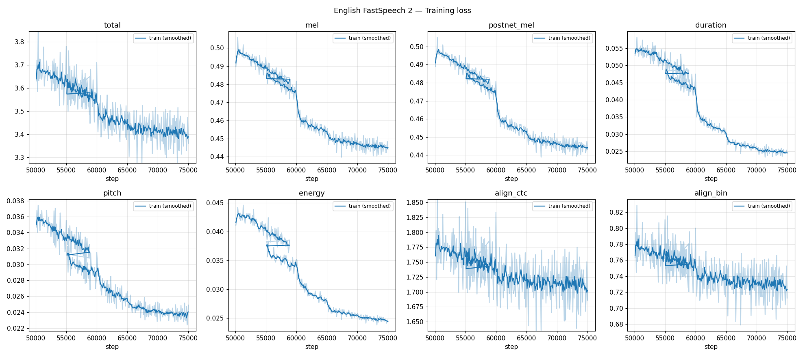
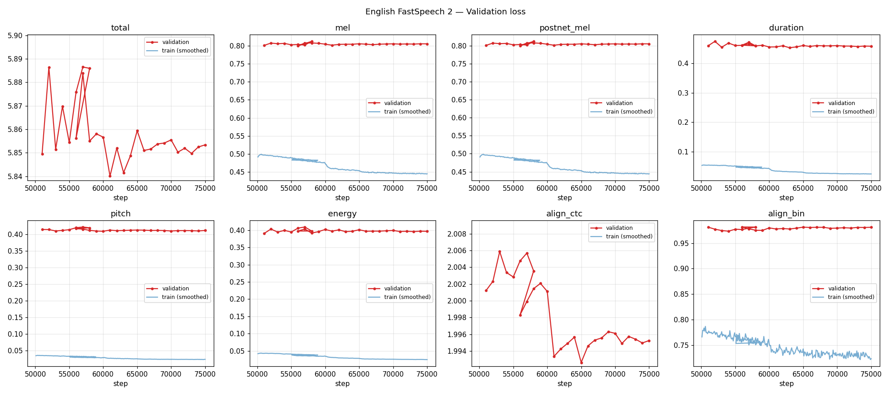
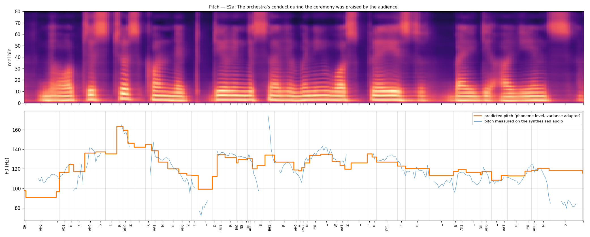
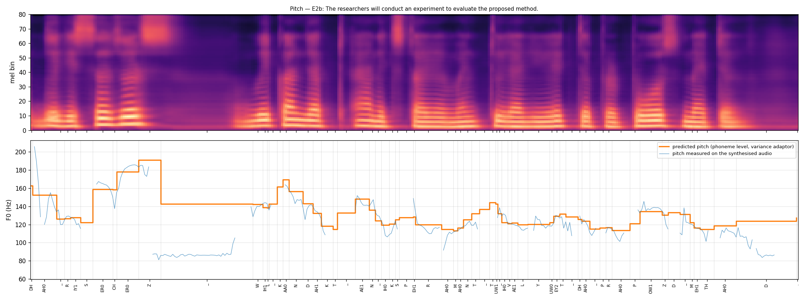
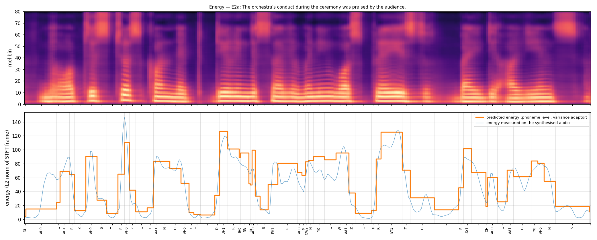
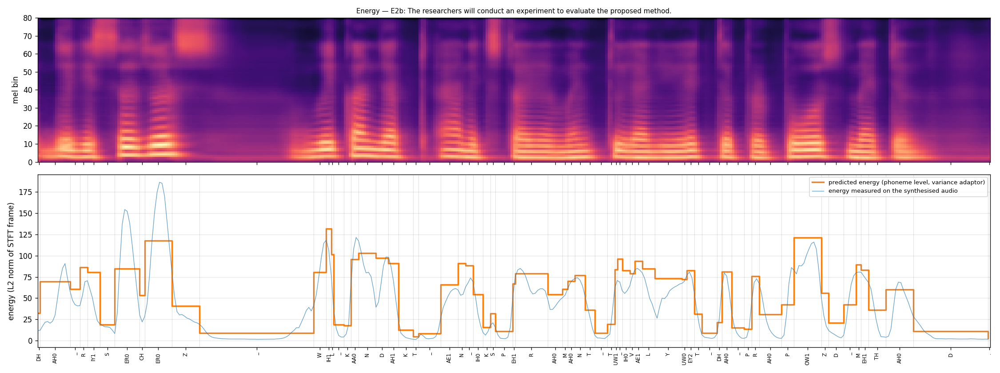
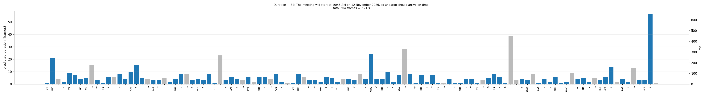
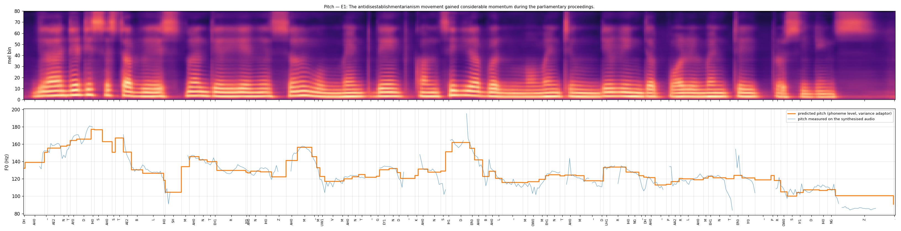

# FastSpeech 2 Text-to-Speech for English and Telugu — Technical Report

**Author:** Chakradhar Adla  **Repository:** https://github.com/Pixie7Mage/Multilingual-FastSpeech2  **Date:** 7 November 2026

> **Submission status:** Both language models have completed training. The submitted English model is the 75,000-step continuation checkpoint; the submitted Telugu model is the 50,000-step checkpoint. Checkpoint weights are distributed separately from the source repository.

---

## 1. Implementation approach

Two FastSpeech 2 models with the same architecture were trained separately: one on English (Svarah, Indian-accented, multi-speaker) and one on Telugu (IndicTTS Telugu, single speaker). The code base is the PyTorch implementation by ming024 [2] of Ren et al. [1]. The shared model code is in `fs2/`, and each language has its own `prepare_data.py`, `preprocess.py`, `train.py`, `inference.py` and `config.yaml` in `English/` and `Telugu/`.

### 1.1 Components taken from the reference implementation

| Component | Configuration | Location |
|---|---|---|
| Phoneme encoder | 4 FFT blocks, hidden 256, 2 heads, conv filter 1024, kernels [9, 1], dropout 0.2, sinusoidal positions | `fs2/transformer/` (unchanged) |
| Variance adaptor | duration, pitch and energy predictors (2 × Conv1D(k=3, 256)–ReLU–LayerNorm–Dropout 0.5 + Linear); length regulator; 256-bin linearly quantised pitch/energy embeddings | `fs2/model/modules.py` |
| Mel decoder + PostNet | 6 FFT blocks (as in ming024's LJSpeech config; the paper uses 4), linear projection to 80 mel bins, 5-layer convolutional PostNet with a residual connection | `fs2/transformer/`, `fs2/model/fastspeech2.py` |
| Loss | L1 on mel before and after the PostNet; MSE on log(duration + 1), on phoneme-level pitch and on energy | `fs2/model/loss.py` |
| Optimiser | Adam (β = 0.9/0.98, ε = 1e-9), Noam schedule with 4 000 warm-up steps, ×0.3 annealing, gradient clip 1.0, batch 16 | `fs2/model/optimizer.py` |
| Speaker conditioning | learned speaker embedding added to the encoder output (ming024 `multi_speaker`), used for English only | `fs2/model/fastspeech2.py` |
| Vocoder | pretrained universal HiFi-GAN [4] shipped with ming024, not fine-tuned | `fs2/hifigan/` |

Two choices in ming024 that differ from the paper were kept. Pitch and energy are predicted at **phoneme level**, following FastPitch, instead of the paper's frame-level continuous-wavelet pitch spectrogram. The vocoder is HiFi-GAN instead of Parallel WaveGAN.

### 1.2 Modifications for both languages

| Area | Reference (ming024) | This work | Reason |
|---|---|---|---|
| Duration targets | Montreal Forced Aligner (MFA) TextGrids, computed offline | **Internal unsupervised aligner** (Badlani et al. [3]): convolutional text–mel attention, beta-binomial alignment prior, forward-sum (CTC) loss, Monotonic Alignment Search (MAS, numba) for hard durations, binarisation (KL) loss ramped in from step 4 000 over 4 000 steps (`fs2/model/aligner.py`) | MFA has no Telugu acoustic model or lexicon, and its US-English model fits Indian-accented speech poorly |
| Aligner text embedding | n/a | **Separate embedding for the aligner** (`own_embedding: true`) | When the aligner shared the encoder's embedding, the duration/mel losses fed back into the alignment that produced their own targets. The alignment collapsed: 76 % of tokens got 1 frame and the validation CTC loss was 7–12. With a separate embedding the validation CTC loss fell steadily (2.20 → 2.03 for English) |
| Pitch/energy targets | phoneme averages computed in preprocessing from MFA durations | frame-level F0/energy stored; phoneme averages computed on the fly from the MAS durations (`average_by_duration`) | no external alignment needed |
| Mel extraction | `audio/stft.py` (positional `librosa.filters.mel` call fails on librosa ≥ 0.10) | HiFi-GAN-identical log-mel (`fs2/audio.py`) | compatibility, exact vocoder match |
| Length regulator | Python loop with a CUDA-only global `device` | `repeat_interleave`, device-agnostic | runs on CPU/MPS too |
| Energy control | the energy branch received the *pitch* control factor | fixed (`e_control`) | correctness |
| Inference durations | rounded and clamped at ≥ 0 frames (a phoneme can disappear) | clamped at ≥ 1 frame | MAS gives every token ≥ 1 frame in training |
| Training loop | fixed-interval checkpoints | auto-resume from `latest.pth`, best-validation checkpoint, CSV logs, fp16 inference export, optional periodic checkpoint retention (`keep_every`) | resumable on Kaggle/Colab |
| Beta-binomial prior | n/a | one vectorised `scipy` call; cache capped at 500 entries | the per-row version was slow, and an unbounded cache duplicated in every DataLoader worker exhausted RAM (kernel died at step 12 600) |

### 1.3 English-specific changes (`fs2/text/english.py`)

- **Normalisation:**
    - clock times ("10:45 AM" → "ten forty five ay em");
    - dates ("12 November 2026" → "the twelfth of November twenty twenty six");
    - ordinals, years, currency, percent and abbreviations;
    - digit strings of five or more digits are read digit by digit, as Svarah speakers read phone and account numbers.
- **G2P:** g2p_en is run on the whole sentence, so its POS tagger can resolve heteronyms ("conduct" noun **K AA1 N D AH0 K T** vs verb **K AA0 N D AH1 K T**). Out-of-vocabulary words use its neural G2P. The symbol set is 39 ARPAbet phonemes with stress (69 symbols), punctuation `, . ? !`, a word-boundary token `_` and padding.
- **Lexicon override:** `English/lexicon_override.txt` maps the code-mixed Telugu word *andaroo* to `AA1 N D AH0 R UW0`.
- **Split-word repair:** two adjacent tokens are joined when the first is not a CMUdict word and the joined form is ("rhyth m" → "rhythm"). Correctly spelled text is never changed. This is applied at inference only.
- **Multi-speaker conditioning:** Svarah on the Hugging Face Hub has no speaker-ID column. A pseudo speaker ID is the MD5 of the speaker-metadata columns (gender, age group, primary language, state, district, qualification, job category, occupation domain), which gives 115 IDs for 117 speakers.
- **Inference speaker:** chosen by ASR word error rate (WER) rather than amount of data (§4.1): `svarah_cfdf65f7`, set in `English/config_v3.yaml → inference.speaker`.

### 1.4 Telugu-specific changes (new; ming024 has no Telugu support) — `fs2/text/telugu.py`

- **Rule-based G2P for the Telugu abugida:**
    - every consonant carries an inherent /a/ unless followed by a vowel sign (matra) or the virama ్, which gives conjuncts and geminates (పట్టు → `p a tt tt u`);
    - independent vowels and matras map to short/long vowel phonemes;
    - the anusvara ం becomes the homorganic nasal of the next consonant (బలంగా → `b a l a ng g aa`, ఉంచండి → `u ny c a nn dd i`), or /m/ word-finally and before sonorants (సమావేశం → `… sh a m`);
    - the visarga becomes /h/, vocalic ఋ/ృ becomes /r u/, and candrabindu, nukta, ZWJ and ZWNJ are dropped.
    - The inventory is 12 vowels, 40 consonants, 4 punctuation marks and `_` (57 symbols + padding).
- **Telugu number normalisation:** cardinals up to crores, years (2026 → రెండు వేల ఇరవై ఆరు), ordinal suffix వ (12వ → పన్నెండవ), clock times (10:45 → పది నలభై ఐదు) and decimals. IndicTTS transcripts contain no digits, but T4 does.
- **Split-word repair:** a corpus-frequency merge using the training transcripts as a word list. Two neighbours are joined only if the joined form is more frequent in the corpus than either fragment ("అడ విలో" → "అడవిలో"). Applied at inference only.
- **Single-speaker model:** the voice with the most audio is used: **te_male** (8.07 h available, against 3.74 h for te_female).

---

## 2. Datasets, preprocessing and training configuration

### 2.1 Selection and subsampling (`fs2/prepare_data.py`, seed 1234)

1. **Download:** parquet shards are fetched directly from the Hugging Face Hub (`ai4bharat/Svarah`, which is gated and needs a token; `SPRINGLab/IndicTTS_Telugu`) and the embedded audio bytes are decoded with soundfile.
2. **Filters:**
    - 1–15 s duration and at least 2 words;
    - English: no bracketed noise tags, and only the characters `A–Z a–z 0–9 . , ? ! ' - : ; " % & $ ₹ ( ) /`;
    - Telugu: Telugu script only (no Latin letters).
3. **Validation (~1 h):** seeded random utterances, drawn per speaker in proportion to each speaker's share of the audio.
4. **Training (~5 h):** seeded random utterances from the remainder, **excluding every utterance whose normalised transcript also occurs in validation**. The splits are therefore disjoint both by utterance ID (asserted in code) and by sentence text.
5. **Resampling:** all audio is resampled to 22 050 Hz mono, 16-bit PCM.

| | English (Svarah) | Telugu (IndicTTS) |
|---|---|---|
| Training utterances / hours (selected) | 3 192 / 5.00 h | 2 322 / 5.00 h |
| Validation utterances / hours (selected) | 727 / 1.11 h ¹ | 496 / 1.00 h |
| Utterances used in training / validation after preprocessing | 3 192 / 727 | 2 322 / 496 |
| Speakers | 115 pseudo-IDs (≈ 117 real); ≈ 2.6 min of training audio per speaker; the same speakers occur in train and validation, with different sentences | 1 (te_male) |
| Text overlap between train and validation | 0 (by construction) | 0 (by construction) |

¹ The per-speaker quota loop adds one utterance beyond each speaker's quota, so validation is slightly above 1 h.

### 2.2 Preprocessing (`fs2/preprocess_core.py`)

1. Load at 22 050 Hz, trim leading/trailing silence (top_db 40) with a 50 ms margin, peak-normalise to 0.95.
2. 80-bin log-mel identical to HiFi-GAN's (FFT 1024, hop 256 = 11.6 ms, window 1024, 0–8 kHz, reflect padding, log of clamp(·, 1e-5)).
3. Frame energy = L2 norm of each STFT magnitude frame.
4. F0 with WORLD DIO + StoneMask (English 60–500 Hz, Telugu 70–600 Hz); unvoiced frames are linearly interpolated.
5. F0 and energy are z-normalised with **training-set** mean and standard deviation; the min/max of the normalised values define the 256 quantisation bins.
6. Text → normalised text → phonemes → IDs. Utterances are dropped if longer than 1 400 frames (≈ 16 s), shorter than 1.2 frames per phoneme, or with fewer than 5 voiced frames.

### 2.3 Training configuration (`English/config_v3.yaml`, `Telugu/config.yaml`)

| Setting | English | Telugu |
|---|---|---|
| Parameters | ≈ 35.8 M | 35.79 M |
| Steps | 75 000 | 50 000 |
| Batch / optimiser | 16; Adam with the Noam schedule (peak LR ≈ 9.9e-4 at 4k steps) | same |
| LR annealing | ×0.3 at 30k, 40k, 45k | same |
| Aligner | CTC weight 1, binarisation weight 1 (start 4k, warm-up 4k), separate embedding, prior scaling 1 | same |
| Validation | full validation set every 1 000 steps; best checkpoint after 10k steps, by mel + postnet + duration + pitch + energy | same |
| Hardware / speed | Kaggle NVIDIA Tesla T4, ≈ 0.58 s/step during the initial run; continuation resumed from a saved checkpoint | Kaggle NVIDIA Tesla T4, ≈ 0.66 s/step, ≈ 9 h |
| Software | Python 3.13, PyTorch 2.11 (CUDA 13) | same |

Compared with ming024's LJSpeech recipe (24 h of data, 900k steps, annealing at 300k/400k/500k), the schedule is compressed to 75k steps for English and 50k steps for Telugu, using 5 h of selected training audio per language.

---

## 3. Training and validation loss



*Figure 1. English training losses.*



*Figure 2. English validation losses.*

The Telugu training and validation loss values are included in the table below. Separate Telugu loss-plot images were not present in the supplied report files, so no plot is embedded here.

The initial English run resumed from a step-5,000 checkpoint after a Kaggle session reset; consequently, its available logs start at step 6,000 and the first 5,000 steps are not represented in the original loss plots. English was subsequently continued using `config_v3` and completed at 75,000 steps. Telugu completed at 50,000 steps. The final English metrics below are from the 75k continuation; the intermediate 8k–50k rows preserve measurements from the original run. All validation values are averages over the full validation set.

| Step | Train mel | Val mel | Train dur. | Val dur. | Train pitch | Val pitch | Val energy | Val align CTC |
|---|---|---|---|---|---|---|---|---|
| **English** 8k | 0.711 | 0.803 | 0.286 | 0.550 | 0.137 | 0.433 | 0.412 | 2.200 |
| 15k | 0.616 | 0.802 | 0.137 | 0.504 | 0.073 | 0.433 | 0.403 | 2.085 |
| 31k (best checkpoint) | 0.499 | 0.797 | 0.051 | 0.470 | 0.036 | 0.419 | 0.404 | 2.031 |
| 50k (initial run) | 0.468 | 0.806 | 0.028 | 0.472 | 0.027 | 0.422 | 0.409 | 2.028 |
| **75k (submitted final)** | **0.4442** | **0.8053** | — | **0.4580** | — | **0.4117** | **0.3970** | **1.9953** |
| **Telugu** 37k | 0.358 | 0.562 | 0.010 | 0.088 | 0.014 | 0.450 | 0.163 | 1.232 |
| 50k (final) | 0.350 | 0.564 | 0.008 | 0.088 | 0.012 | 0.450 | 0.163 | 1.226 |

**Convergence:**
- In the initial English run, training mel loss decreased from 0.71 to 0.47. The continuation reduced the final training mel loss further to 0.4442. Validation mel reached approximately 0.7998 at 56k and remained nearly flat; the 75k value was 0.8053.
- English validation duration loss improved from 0.550 at 8k to 0.4580 at 75k.
- English validation alignment (CTC) loss improved from 2.200 at 8k to 1.9953 at 75k; alignment images became clean diagonals within the first few thousand steps. The final English validation PostNet mel loss was 0.8051.
- The binarisation loss is ramped in from 4k to 8k, which raises the total loss by about 1.0 (visible as a step in `align_bin`). It then settles at about 0.98 on validation.
- The ×0.3 LR drop at 30k gives a visible step down in training loss (mel 0.528 → 0.499) and no change in validation loss.
- Telugu had converged by step 36k: validation mel stayed in the 0.562–0.564 range through the 50k final step, and the 40k/45k annealing steps did not change it.
- No instability (spikes, NaNs, divergence) occurred in either run after the aligner fix.

**Overfitting:**
- The original 50k logs show a substantial train–validation gap in the variance predictors. At 50k, English pitch loss was 0.027 train vs 0.422 validation; Telugu pitch was 0.012 vs 0.450 and Telugu energy was 0.011 vs 0.163. These are the original-run figures, not the 75k continuation's training metrics.
- In the original English run, the mel gap grew from 0.09 at 8k to 0.34 at 50k.
- With 5 h of data the predictors memorise the per-utterance prosody of the training sentences. English is worse because 115 speakers share about 2.6 minutes of audio each, and pitch is normalised globally rather than per speaker.

**Validation loss is a poor model-selection criterion here.** The validation pass is *teacher-forced*: the decoder receives the aligner's durations and the true pitch and energy. Validation mel remained nearly flat after the early part of training, while ASR intelligibility improved with continued training. The lowest-summed-validation-loss checkpoint was therefore not selected as the submitted model. The submitted English checkpoint is the 75k continuation (`English/checkpoints_v3/final_fp16.pth`); the submitted Telugu checkpoint is the 50k model (`Telugu/checkpoints/final_fp16.pth`).

---

## 4. Generated speech

The audio is in `Results/<language>/test_generated_audios/<ID>.wav`. The sentence text is used exactly as provided; any repair happens inside the text front-end.

### 4.1 Objective intelligibility (English)

To get a number that does not depend on subjective listening, Whisper small.en (faster-whisper, beam 5) transcribed 30 held-out **validation** sentences (6–20 words, no digits, never seen in training). The script is `English/asr_baseline.py`. The 75k row is the submitted English model's result. The 50k and baseline rows are retained for comparison; the true-prosody row is a diagnostic in which the model is supplied with reference durations, pitch and energy.

| System (same 30 held-out sentences) | WER |
|---|---|
| Real recordings (ASR ceiling on Indian-accented speech) | **9.0 %** |
| Real mel → HiFi-GAN (vocoder only) | 9.9 % |
| FastSpeech 2, step 31k ("best" checkpoint), each sentence's own speaker | 41.1 % |
| FastSpeech 2, step 50k (initial-run checkpoint) | 36.3 % |
| FastSpeech 2, **step 75k (submitted English checkpoint)** | **31.2 %** |
| Step 50k, given the aligner's durations and real pitch/energy | 50.2 % |
| Step 75k, given the aligner's durations and real pitch/energy | **46.8 %** |
| Variant v2 (4-layer decoder, dropout 0.3), step 13k / 20k | 52.9 % / 51.4 % |

What this shows:
1. **The vocoder is not the bottleneck.** It adds only 0.9 points over real speech.
2. **The variance predictors are not the main bottleneck in this diagnostic.** Supplying reference durations, pitch and energy still gives a higher WER than normal synthesis (50.2% at 50k; 46.8% at 75k, versus 31.2% for normal 75k synthesis). The remaining errors are consistent with incorrect phoneme spectra from the decoder: "sitcom" becomes "sick of" and "goals" becomes "course".
3. **More capacity and longer training help; extra regularisation hurts.** The smaller, more regularised v2 performed worse. Extending the original English model from 50k to 75k improved WER from 36.3% to 31.2%, although the validation mel loss changed very little.

**Speaker choice matters a great deal.** The following is the exploratory 50k-checkpoint speaker sweep over 12 speakers, using 15 held-out and 5 test sentences (`English/speaker_sweep.py`). It is retained as a diagnostic comparison; it is not the 75k final-model evaluation:

| Speaker (training audio) | duration_control | Held-out WER | Test-sentence WER |
|---|---|---|---|
| svarah_cfdf65f7 (7.7 min) — **selected** | 1.0 | 27.1 % | 29.7 % |
| svarah_f0bb6d4e (5.4 min) | 1.15 | 25.9 % | 34.4 % |
| svarah_8f8ba735 (5.5 min) | 1.0 | 27.6 % | 32.8 % |
| svarah_d270faea (most data; former default) | 1.0 | 62.4 % | 46.9 % |

Each cell is based on only about 170 (held-out) or 64 (test) words, so the top settings are within noise of each other. `svarah_cfdf65f7` has the best combined held-out and test WER in this 50k sweep and is the speaker selected in the English inference configuration. The per-sentence 50k diagnostic examples below still use the former default speaker `svarah_d270faea`.

### 4.2 English — per test sentence

The detailed sentence-level examples and acoustic measurements in §§4.2 and 5.1–5.2 are from the original 50k diagnostic output (`Results/English_final/inference_summary.json`, speaker `svarah_d270faea`, controls 1.0). They are retained to document front-end and variance-adaptor behaviour; the submitted English checkpoint is the 75k model.

| ID | Duration | Front-end output (key part) | Observations |
|---|---|---|---|
| E1 | 6.28 s, 97 tokens, 13.9 phones/s | *antidisestablishmentarianism* → 28 phonemes `AE2 N T AY0 D IH0 S AH0 S T AE2 B L IH0 SH M AH0 N T EH1 R IY0 AH0 N IH0 Z AH0 M` (g2p_en) | The fastest of the five sentences; the long word lasts 1.90 s and keeps all its syllables. The main stress (EH1) is on "-ar-". The final /z/ of "proceedings" is stretched to 418 ms (see §5). |
| E2a | 4.08 s | *conduct* (noun) → `K AA1 N D AH0 K T` | The heteronym is resolved correctly from POS context, giving first-syllable stress. |
| E2b | 4.45 s | *conduct* (verb) → `K AA0 N D AH1 K T` | Correct verb stress in the phoneme string. The duration predictor inserts an unnatural 534 ms pause after "researchers". |
| E3 | 3.14 s | committed audio: `R AY1 DH _ EH1 M` ("rythe" + letter "M") | **Failure** in the committed audio: the split token is read as two words. The repaired front-end gives `R IH1 DH AH0 M` ("rhythm") while leaving the input text unchanged. Regenerate E3 with the current code. |
| E4 | 7.71 s | `T EH1 N _ F AO1 R T IY0 _ F AY1 V _ EY1 _ EH1 M`; `DH AH0 _ T W EH1 L F TH _ AH1 V _ N OW0 V EH1 M B ER0 _ T W EH1 N T IY0 _ T W EH1 N T IY0 _ S IH1 K S`; *andaroo* → `AA1 N D AH0 R UW0` | Time, date and year are expanded correctly; the code-mixed word follows the lexicon. A 453 ms pause is placed at the comma. The final /m/ of "time" is stretched to 650 ms. |

The sentence-level table above is a 50k diagnostic sample. The objective 75k evaluation in §4.1 is the result reported for the submitted English model.

### 4.3 Telugu — per test sentence

The numbers below are from the 50k diagnostic checkpoint (`Results/Telugu/inference_summary.json`, speaker te_male, all controls 1.0).

| ID | Duration, rate | Front-end output (key part) | Observations |
|---|---|---|---|
| T1 | 4.68 s, 72 tokens, 14.1 phones/s | `n y uu r oo ph aa r m a k oo l aa j i k a l _ p a r i sh oo dh a n a l oo _ …` | The 19-phoneme loan compound న్యూరోఫార్మకోలాజికల్ is produced as one word of 1.36 s with no internal pause. ఫ is read as aspirated `ph`, although the English loan has /f/. If the input keeps the spaces of the brief ("న్యూ రోఫార్మ కోలాజికల్"), the corpus merge cannot rejoin it because the word is not in IndicTTS, so it would be read as three words. |
| T2a | 2.38 s, 13.0 phones/s | `t aa dd u p ai _ a t a n i _ p a tt tt u _ c aa l aa _ b a l a ng g aa _ u n d i .` | పట్టు = "grip". The geminate `tt tt` and the anusvara before g → `ng` are correct. A long 186 ms boundary after తాడుపై sets the topic phrase apart. |
| T2b | 2.55 s, 14.5 phones/s | `aa m e _ p a tt tt u _ c ii r a n u _ dh a r i ny c i _ v ee dd u k a k u _ v a c c i n d i .` | పట్టు = "silk": the same phonemes as T2a, so the two senses can differ only through context. They do differ in prosody (§5.4), but not in a way that marks the meaning. The utterance-initial `aa` is stretched to 186 ms. |
| T3 | 1.86 s, 16.7 phones/s | `p u l i _ a dd a _ v i l oo _ n i sh sh a b d a ng g aa _ …` | **Failure in this output:** అడవిలో is still split (`a dd a _ v i l oo`), so the corpus merge did not run in this inference. The inserted boundary is the shortest one in the sentence (35 ms), so the audible break is small. The fastest sentence. |
| T4 | 8.01 s, 138 tokens, 14.9 phones/s | `ii _ s a m aa v ee sh a m _ r e nn dd u _ v ee l a _ i r a v ai _ aa r u _ n a v a m b a r _ p a n n e nn dd a v a _ t ee d ii _ u d a y a m _ p a d i _ n a l a bh ai _ ai d u _ …` | 2026 → రెండు వేల ఇరవై ఆరు, 12వ → పన్నెండవ and 10:45 → పది నలభై ఐదు are expanded correctly. The comma pause is 511 ms (`,` 70 ms + `_` 441 ms). A spurious 209 ms pause splits the number నలభై \| ఐదు ("forty \| five"). |

Subjective listening indicated that the 50k Telugu output had good pronunciation, clarity, naturalness and pause placement. The remaining issues identified in the detailed analysis are the /f/ realisation in the loan word and the pause inside the spoken number sequence.

---

## 5. Variance-adaptor analysis (duration, pitch F0, energy)

**Checkpoint scope:** The detailed English and Telugu sentence-level measurements in this section describe the 50k diagnostic outputs used for the original plots. They are retained as qualitative/phonetic analysis and should not be read as measurements from the submitted 75k English checkpoint.

Each sentence has three plots: `duration/<ID>.png` (predicted frames per token; grey bars are `_` and punctuation), and `pitch/<ID>.png` and `energy/<ID>.png`. The pitch and energy plots show the predicted mel-spectrogram, the phoneme-level prediction (orange, de-normalised to Hz / energy units), and the F0 or energy measured on the synthesised waveform (blue), which shows how faithfully the decoder and vocoder realise the predicted prosody.

### 5.1 English — patterns common to all five sentences

| Measure | E1 | E2a | E2b | E3 | E4 |
|---|---|---|---|---|---|
| Mean stressed / unstressed vowel duration (ms) | 41 / 59 | 67 / 64 | 48 / 75 | 75 / 126 | 55 / 82 |
| Mean stressed / unstressed vowel energy | 78.0 / 76.7 | 90.5 / 76.4 | 90.8 / 72.8 | 86.4 / 56.7 | 86.2 / 68.2 |
| Predicted F0, first → last third of sentence (Hz) | 144 → 117 | 127 → 119 | 146 → 123 | 127 → 120 | 144 → 127 |
| Predicted / measured mean F0 (Hz) | 129 / 126 | 124 / 119 | 132 / 122 | 127 / 123 | 136 / 128 |
| Duration of the last phoneme before "." (ms) | 418 (Z) | 244 (S) | 348 (D) | 337 (IY0) | 650 (M) |

- **Stress is carried by energy, not by duration.** Stressed vowels have clearly higher predicted energy than unstressed ones, but they are not longer; unstressed vowels are often longer. This matches the syllable-timed rhythm of Indian English, where prominence is cued by intensity and pitch more than by vowel length. The duration predictor has learned the Svarah speakers' rhythm rather than a US-English stress-timed rhythm.
- **Declination:** in every sentence the predicted F0 falls from the first to the last third (8–27 Hz). The F0 peak is on the first content word (token index 7–9). Declarative sentences end low.
- **The decoder and vocoder realise slightly lower F0 than predicted** (3–10 Hz). This is consistent with the 256-bin quantisation and smoothing of the pitch embedding.
- **Edge artefacts:**
    - The utterance-initial "the" vowel AH0 is predicted at 139–244 ms in all sentences, about three times a normal unstressed vowel.
    - The final "." gets a single frame, and the last phoneme absorbs 244–650 ms.
    - Both happen because the training audio keeps up to 50 ms of residual silence and breath at the edges after trimming, there is no explicit start/end silence token, and MAS must assign those frames to the first and last real tokens.
    - The outcome is audible phrase-final over-lengthening (strongest on E4's "time").
- **Pauses:** word boundaries `_` average 60–100 ms. The comma in E4 gets 453 ms, a correct prosodic break. Spurious long word-boundary pauses also occur: 534 ms after "researchers" (E2b) and 325 ms inside the date (E4).
- **Energy dips at obstruents:** stop closures fall to energy 5–17 (e.g. the K and T of "conduct"), against 70–100 for vowels and nasals.

### 5.2 English — per sentence

**E1.** The 28-phoneme word occupies 1.90 s, about 30 % of the utterance. Its durations are uniform, with no lengthening of the main-stress syllable `EH1` and no pause inside the word. The F0 peak (177 Hz) is early, on "antidis-". The contour then declines steadily to about 117 Hz, and energy dips at each /s t/ cluster. The F0 measured on the audio follows the prediction closely (126 vs 129 Hz).

**E2a vs E2b ("conduct"):**

| | K | first vowel | N | D | second vowel | K | T |
|---|---|---|---|---|---|---|---|
| E2a noun — ms / Hz / energy | 46 / 145 / 16.9 | **AA1** 46 / 139 / **83.6** | 70 / 127 / 83.4 | 81 / 120 / 72.8 | AH0 58 / 116 / 52.0 | 35 / 114 / 9.7 | 46 / 114 / 7.2 |
| E2b verb — ms / Hz / energy | 35 / 162 / 17.8 | AA0 35 / 170 / 95.4 | 81 / 156 / 102.8 | 58 / 143 / 97.3 | **AH1** 46 / 132 / **90.8** | 70 / 118 / 12.7 | 23 / 115 / 4.8 |

- **Noun:** a clear first-syllable prominence. The first vowel has 61 % more energy and 23 Hz higher F0 than the second.
- **Verb:** the second vowel is longer than the first (46 vs 35 ms) and nearly as loud (90.8 vs 95.4). The energy contrast therefore shifts toward the second syllable, so the stress shift is realised.
- **But not in pitch:** F0 still falls through the word (170 → 132 Hz), because the verb sits early in the sentence on the declining contour.






**E3.** In the committed output, `R AY1 DH _ EH1 M` produces a word-boundary pause (`_`) inside "rhythm" and a stressed `EH1` that does not belong. The longest tokens are the initial AH0 (232 ms) and the final IY0 of "unexpectedly" (337 ms). F0 is flat (127 → 120 Hz).

**E4.**
- **Speed:** the longest sentence (110 tokens), and the slowest at 11.0 phones/s, because it has 23 word boundaries and a comma.
- **Number expansion:** "ten forty five ay em" and "twenty twenty six" are spoken with short regular boundaries.
- **Comma:** the comma (453 ms) is the main prosodic break. It comes after a falling F0 on "six" and is followed by a pitch reset on "so andaroo".
- **"andaroo":** gets normal prominence on AA1.
- **End:** the final /m/ of "time" is the longest token in the test set (650 ms), the edge artefact described above.




### 5.3 Telugu — patterns common to all five sentences

| Measure | T1 | T2a | T2b | T3 | T4 |
|---|---|---|---|---|---|
| Mean short / long vowel duration (ms) | 55 / 80 | 57 / 84 | 60 / 120 | 52 / 64 | 46 / 75 |
| Mean vowel / consonant energy | 70 / 42 | 81 / 40 | 67 / 37 | 79 / 39 | 68 / 44 |
| Predicted F0, first → last third of sentence (Hz) | 230 → 157 | 195 → 154 | 217 → 159 | 202 → 158 | 194 → 165 |
| Predicted / measured mean F0 (Hz) | 196 / 200 | 179 / 183 | 190 / 198 | 184 / 189 | 187 / 188 |
| Last phoneme / final "." (ms) | 58 / 12 | 81 / 46 | 70 / 35 | 46 / 46 | 46 / 46 |

- **Phonemic vowel length is learned.** Across the five sentences, long vowels (aa, ii, uu, ee, oo; n = 32) average 82 ms against 52 ms for short vowels (n = 94), a ratio of 1.6. In Telugu vowel length is contrastive and written explicitly, which is why the validation duration loss is so low (0.088 vs 0.47 for English).
- **Geminates get a long closure with an energy dip:**
    - పట్టు `tt tt`: 93 ms (T2a) and 116 ms (T2b), with energy 4.6–17;
    - వచ్చింది `c c`: 81 ms, with energy 2–19;
    - నిశ్శబ్దంగా `sh sh`: 139 ms.
    - In each case the first half of the geminate is the longer one (the closure), and the second half is the release.
- **Strong declination and a wide pitch range.** Predicted F0 spans 101–283 Hz and falls by 30–73 Hz from the first to the last third of every sentence. Each sentence ends at 101–122 Hz. The range is wider than for the English speaker (90–190 Hz), reflecting the expressive read style of the IndicTTS recordings. Peaks fall on the first content word (T1 `oo` of న్యూరో 283 Hz; T3 `i` of పులి 263 Hz).
- **The decoder and vocoder reproduce the predicted F0 closely** (measured mean 1–8 Hz above prediction). The English model instead realised F0 slightly below its prediction.
- **No edge over-lengthening.** Unlike English, the last phoneme is short (46–81 ms) and the final "." gets 3–4 frames of silence. IndicTTS is studio speech with clean, consistent leading and trailing silence, so MAS can assign it to the punctuation token. The only edge effect is a lengthened first segment in T1 (`n` 128 ms) and T2b (`aa` 186 ms).
- **Pauses:**
    - word boundaries `_` average 64–107 ms;
    - the T4 comma gives the longest pause (511 ms), with near-zero energy;
    - spurious long boundaries occur inside the number "నలభై | ఐదు" (209 ms) and after the first word ఈ (151 ms) in T4.
- **Energy:** vowels 67–81 against consonants 37–44. Voiceless stops drop to 2–7 (k, t, p), and nasals and liquids stay high (50–90).

### 5.4 Telugu — per sentence

**T1.** The F0 starts high on the loan word (226–283 Hz over న్యూరో) and steps down word by word to 109 Hz on the final `u` of విశ్లేషించారు, a clear declarative contour. Inside the compound, the long vowels `oo` and `aa` (58–81 ms) are longer than the short `a`/`i` (46–70 ms). Energy dips at each `k` (4.8–5.0) and the aspirated `ph` (20.4).

**T2a vs T2b (పట్టు):**

| | p | a | tt | tt | u | total |
|---|---|---|---|---|---|---|
| T2a "grip" — ms / Hz / energy | 35 / 204 / 25 | 46 / 165 / 66 | 70 / 166 / 4.6 | 23 / 203 / 7.4 | 46 / 214 / 73 | 221 ms |
| T2b "silk" — ms / Hz / energy | 46 / 216 / 29 | 58 / 205 / 98 | 81 / 197 / 7.6 | 35 / 222 / 17 | 35 / 253 / 95 | 255 ms |

The phoneme strings are identical. In T2b the word is 15 % longer, has 40–50 Hz higher F0 on the vowels and is louder. This follows from its position: it is the second word, right after the short subject ఆమె, near the sentence's F0 peak. In T2a it comes after the pause following తాడుపై అతని. These are positional effects, so the model has no way to express the grip/silk distinction itself.

**T3.** The shortest and fastest sentence (16.7 phones/s). F0 peaks on పులి (263 Hz) and falls to 122 Hz on నడిచింది. The `sh sh` geminate of నిశ్శబ్దంగా is the longest consonant (139 ms in total). The split అడ | విలో gets only a 35 ms boundary, with no F0 reset (200 → 179 Hz). The fragment is spoken almost as one word, but the energy dip at the boundary (44.8) is still visible.

**T4.**
- **The longest sentence:** 138 tokens, 8.0 s.
- **Number groups:** the expanded date and time keep regular word boundaries (23–93 ms) inside రెండు వేల ఇరవై ఆరు. The 162 ms boundary after తేదీ and the 209 ms one inside నలభై ఐదు are over-long.
- **Comma:** the comma after ప్రారంభమవుతుంది is the main prosodic break. F0 falls to 115 Hz before it and resets to 175–212 Hz on సమయానికి.
- **End:** the final declination reaches 101 Hz on ఉంచండి.

Telugu variance-adaptor figures are in `Results/Telugu/variance_adaptor_plots/{duration,pitch,energy}/T*.png`.

---

## 6. English vs Telugu — comparison, limitations, failures and improvements

| Aspect | English (Svarah) | Telugu (IndicTTS) |
|---|---|---|
| Data | 115 speakers, ≈ 2.6 min each, read and spontaneous Indian-accented speech, varied recording conditions | 1 speaker, studio read speech |
| Validation mel / duration / pitch / energy loss | **0.8053 / 0.4580 / 0.4117 / 0.3970** (75k) | **0.564 / 0.088 / 0.450 / 0.163** (50k) |
| Validation alignment (CTC) loss | 2.03 | 1.23 |
| Text front-end | non-phonemic orthography → g2p_en (dictionary + POS + neural OOV) | near-phonemic script → deterministic rules |

**Comparison.**
- Telugu is easier on every measure except pitch. It has one consistent voice, transcripts that match the audio closely, and a script that spells vowel length and gemination, so durations are almost fully predictable from the text. Its alignment is also better (CTC 1.23 vs 2.03).
- English must model 115 voices from about 2.6 minutes each. Its decoder therefore generalises worse (validation mel 0.805 vs 0.564), which contributes to the 31.2% WER found in §4.1.
- Pitch is poorly predicted in both models (normalised MSE ≈ 0.42–0.45): five hours do not determine sentence-level intonation. Both models still produce a clear declarative contour, but the Telugu one is far more expressive (range 101–283 Hz, declination 30–73 Hz) than the English one (90–190 Hz, 8–27 Hz).
- **Rhythm:** Telugu realises phonemic vowel length (long/short ratio 1.6) and long geminate closures. English stress is cued by energy rather than duration (§5.1), matching syllable-timed Indian English.
- **Sentence edges:** the Telugu model handles them cleanly (final "." 3–4 frames, short last phoneme). The English model over-lengthens the first and last phonemes, because Svarah's recordings have less consistent edge silence.
- **Speaking rate:** Telugu is faster (13.0–16.7 vs 11.0–13.9 phones/s).

**Failures on the test sentences.**
- **E3 / T3 split words:**
    - The committed English audio reads "rhyth m" as two words.
    - In the Telugu output, అడవిలో is still split with a short (35 ms) boundary.
    - Both are fixed in the front-end by merging only when the dictionary or the corpus supports the join, which is robust but data-dependent: Telugu T1 written with spaces cannot be repaired because the compound is not in the corpus. The Telugu merge must also find the training word list at inference.
- **Edge over-lengthening** of the first and last phonemes in every English sentence (§5.1); absent in Telugu.
- **Spurious pauses** inside phrases: E2b, E4, and T4 (inside "నలభై | ఐదు").
- **T2a/T2b homograph:** పట్టు (grip/silk) is spelled and phonemised identically, so the model cannot distinguish the senses.
- **Loan words:** T1 is read with Telugu `ph` for /f/. English code-mixing ("andaroo") needed a manual lexicon entry.

**Limitations.**
- 5 h per language, and only about 2.6 min per English speaker.
- Pitch is normalised globally, so speaker F0 offsets are folded into the English pitch targets.
- Validation losses are teacher-forced, so they do not reflect free-running synthesis quality.
- The universal HiFi-GAN is not fine-tuned. It is not the bottleneck (+0.9 WER), but it could still add naturalness.
- The rule-based Telugu G2P does not model the reduced pronunciation of English loans or sandhi effects.

**Improvements supported by the experiments.**
1. **Choose checkpoints by ASR WER, not validation loss.** The English continuation from the original run to 75k improved WER from 36.3% to 31.2%, despite little change in validation mel loss. The 75k checkpoint is submitted.
2. **Choose the speaker by WER:** 62 % → 27 % with no retraining.
3. **Add explicit leading/trailing silence tokens**, or trim more tightly, to remove the edge over-lengthening.
4. **Normalise F0 per speaker** for multi-speaker English.
5. **Front-end:**
    - always attach a Telugu token that begins with a dependent vowel sign to the previous word, a deterministic rule that needs no corpus;
    - add a mixed English–Telugu phoneme set for code-mixed words;
    - read ఫ in English loans as /f/.
6. **Don't spend effort on more regularisation or a smaller decoder.** v2 tested this and it made things worse: 52.9% / 51.4% WER at 13k / 20k, compared with the stronger main-model results.

---

## 7. Reproducibility

- **Environment:** Python ≥ 3.9 (runs used Python 3.13 with PyTorch 2.11 + CUDA 13 on Kaggle). Install with `pip install -r requirements.txt`. The evaluation scripts additionally need `pip install faster-whisper jiwer`. faster-whisper runs on CPU on CUDA-13 images, because its GPU build needs cuBLAS 12.
- **Seeds:** 1234 for data selection and training.
- **Configurations:**
    - `English/config_v3.yaml`: English continuation configuration used to produce the submitted 75k checkpoint;
    - `Telugu/config.yaml`: Telugu configuration used to produce the submitted 50k checkpoint;
    - `English/config_v2.yaml`: regularised experimental variant; not submitted.
- **Submitted checkpoints:** `English/checkpoints_v3/final_fp16.pth` (75k) and `Telugu/checkpoints/final_fp16.pth` (50k). Both are fp16 inference checkpoints. Model weights are distributed separately from the Git source repository; the repository contains the inference code and instructions.

```bash
pip install -r requirements.txt
# English — Svarah is gated: accept the terms on huggingface.co and create a token
cd English
python prepare_data.py --hf_token hf_xxx     # download + 5 h / 1 h selection -> ../data/English/raw
python preprocess.py                         # mel / F0 / energy / phonemes   -> ../data/English/preprocessed
python train.py --device cuda:0 --workers 2  # initial English training run; see config_v3 for continuation
python inference.py --ckpt checkpoints_v3/final_fp16.pth   # submitted 75k English model
# Telugu
cd ../Telugu
python prepare_data.py && python preprocess.py && python train.py --device cuda:0 --workers 2
python inference.py --ckpt checkpoints/final_fp16.pth   # submitted 50k Telugu model
# Evaluation (optional)
cd ../English
python asr_baseline.py --ckpt checkpoints_v3/final_fp16.pth --device cuda:0 --asr_device cpu --n_val 30
python speaker_sweep.py --ckpt checkpoints_v3/final_fp16.pth --device cuda:0 --asr_device cpu
python diagnose_alignment.py --ckpt checkpoints/latest.pth --device cuda:0
```

**Notes:**
- `inference.py` reads the inference speaker and duration control from the language configuration's `inference` section.
- The English model was trained before the digit-by-digit number rule was added to the front-end. Re-running `preprocess.py` with the current code changes the phonemes of a few training transcripts that contain long digit strings. Inference is unaffected.

## References

1. Y. Ren, C. Hu, X. Tan, T. Qin, S. Zhao, Z. Zhao, T.-Y. Liu, "FastSpeech 2: Fast and High-Quality End-to-End Text to Speech," ICLR 2021, arXiv:2006.04558.
2. C.-M. Chien (ming024), FastSpeech2 — PyTorch implementation, https://github.com/ming024/FastSpeech2.
3. R. Badlani, A. Łańcucki, K. J. Shih, R. Valle, W. Ping, B. Catanzaro, "One TTS Alignment to Rule Them All," ICASSP 2022.
4. J. Kong, J. Kim, J. Bae, "HiFi-GAN: Generative Adversarial Networks for Efficient and High Fidelity Speech Synthesis," NeurIPS 2020.
5. AI4Bharat, "Svarah: Evaluating English ASR Systems on Indian Accents," Interspeech 2023; dataset ai4bharat/Svarah.
6. IIT Madras, Indic TTS database — Telugu (SPRINGLab/IndicTTS_Telugu).
7. A. Radford et al., "Robust Speech Recognition via Large-Scale Weak Supervision" (Whisper), 2022.
